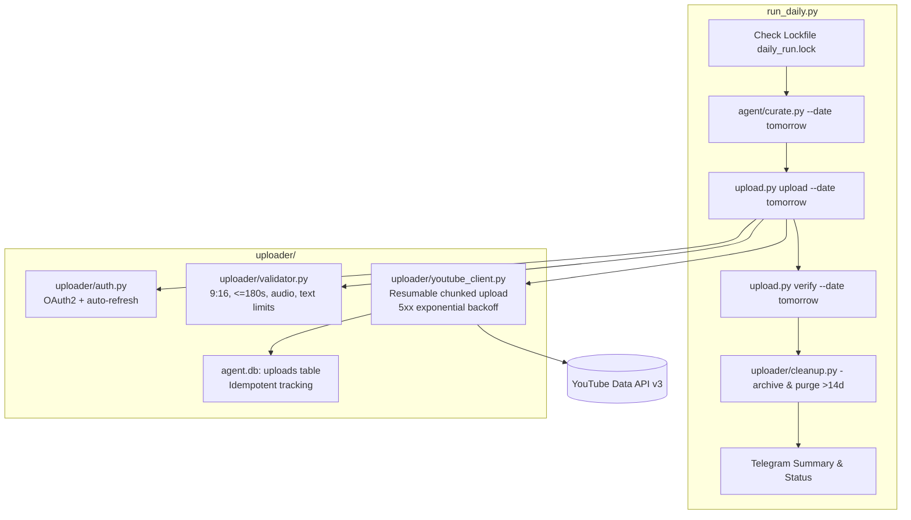

# Phase 4 Implementation Plan: YouTube Upload & Daily Automation

## 1. Architectural Overview



---

## 2. Component Design & File Layout

```
100B/
├── upload.py                      # CLI commands: auth, upload, run-due, verify, status, retry-failed
├── run_daily.py                   # Master daily orchestrator with lock file & error reporting
├── uploader/
│   ├── __init__.py
│   ├── config.yaml                # Upload settings, tags, quota caps, retention days
│   ├── auth.py                    # OAuth token management, browser flow, refresh & fail alerts
│   ├── youtube_client.py          # Resumable upload, chunking (8MB), post-upload privacy check
│   ├── validator.py               # Pre-flight video & metadata inspection
│   ├── db.py                      # SQLite uploads table schema & helper methods
│   ├── cleanup.py                 # Move to data/published/, purge raw/edited > retention_days
│   ├── quota.py                   # Track daily videos.insert calls and estimated quota
│   └── secrets/                   # Ignored by git: client_secret.json, token.json
├── agent/
│   ├── core/
│   │   ├── telegram.py            # Extended with upload alerts & daily run summaries
│   │   └── db.py                  # Add uploads table migration to AgentDatabase
└── tests/
    └── test_uploader/             # 100% mocked Google API tests
        ├── test_auth.py
        ├── test_validator.py
        ├── test_youtube_client.py
        ├── test_idempotency.py
        ├── test_errors_and_quota.py
        ├── test_verify.py
        └── test_daily_orchestrator.py
```

---

## 3. Detailed Specifications by Module

### 3.1 Authentication (`uploader/auth.py`)
* **Libraries**: `google-api-python-client`, `google-auth-oauthlib`, `google-auth-httplib2`.
* **Secrets Location**: `uploader/secrets/client_secret.json` and `uploader/secrets/token.json` (explicitly ignored in `.gitignore`).
* **Interactive Auth (`python upload.py auth`)**:
  * Uses `google_auth_oauthlib.flow.InstalledAppFlow.from_client_secrets_file`.
  * Scopes: `['https://www.googleapis.com/auth/youtube.upload', 'https://www.googleapis.com/auth/youtube.readonly']`.
  * Runs local server on ephemeral port (`flow.run_local_server(port=0)`), prints authorization URL, and writes `token.json` upon callback.
* **Non-interactive Execution**:
  * Loads `token.json`. If expired, calls `creds.refresh(Request())`.
  * If refresh fails (revoked, expired, or missing secrets), catches `google.auth.exceptions.RefreshError`, logs a critical error, sends a Telegram alert (`AUTH_REVOKED`), and immediately halts with exit code 1. **Zero retry loops on auth errors.**

---

### 3.2 Pre-Upload Validation (`uploader/validator.py`)
Before touching YouTube API or consuming any quota, validate candidate files:
1. **File Existence & Size**: File exists on disk, size $> 0$ and $< 256\text{ MB}$.
2. **Aspect Ratio**: Read video dimensions via `ffprobe`; must be 9:16 vertical ($1080\times 1920$) or square ($h \ge w$).
3. **Duration**: $\le 180.0\text{s}$ (3 minutes hard limit per YouTube Shorts specification).
4. **Audio Track**: Must contain at least one valid audio stream.
5. **Text Lengths**:
   * Title $\le 100$ characters. Ensures `#Shorts` tag is included.
   * Description $\le 5000$ characters. Retains LLM description + source credit + `#Shorts`.
* Fail-fast: If any check fails, slot status is set to `failed` with reason `validation_error: <reason>`, logged, and skipped without calling the API.

---

### 3.3 YouTube Client & Resumable Upload (`uploader/youtube_client.py`)
* **Chunking**: Uses `googleapiclient.http.MediaFileUpload` with `chunksize = 8 * 1024 * 1024` (8 MB, multiple of 256 KB) and `resumable=True`.
* **Description Marker & Recovery Ref**:
  * Every uploaded video appends a hidden reference marker in the description: `\n\n[ref:<post_id>]`.
  * Before initiating an upload, `youtube_client.py` scans the channel's uploads playlist for `ref:<post_id>` in recent video descriptions. If found, it recovers the existing `video_id`, writes it to database and `schedule.json`, avoiding duplicate uploads even across crashes or dropped connections.
* **Privacy & Scheduling Rules**:
  * When `first_run_private: true` or `--confirm-public` is missing, upload as `privacyStatus: "private"` WITHOUT `publishAt`.
  * `scheduled` mode sets `publishAt` ONLY when `--confirm-public` is passed or `upload.go_live: true` in config.
* **Slot Timing & Realtime Constraints**:
  * Skip slots that are in the past or less than 15 minutes away (`slot_in_past`).
  * In `realtime` mode: enforce `max_late_minutes` (config, default 30). If current time is past slot_time + max_late_minutes, skip slot as late.
* **Configurable Quota Costs**:
  * Quota costs and daily caps are read dynamically from `uploader/config.yaml` (`daily_cap: 10000`, `insert_cost: 1600`, `list_cost: 1`). Never hardcode 1,600.
* **Immediate & Delayed Verification**:
  * Immediate check: Calls `videos.list(part="status", id=video_id)`. If video ended up private due to unaudited project restrictions, logs clear warning without failing.
  * Delayed verify: Run 2 to 3 hours after the first slot, and again the next morning.
  * `"still processing"` / `"uploaded"` / `"processing"` is treated as healthy in-progress state, NOT a failure. Only `rejected` or `failed` triggers `needs_review`.

---

### 3.4 Decoupled Database Layer (`uploader/db.py`)
* Implemented using plain `sqlite3` on `agent/data/agent.db`.
* **Zero imports from `agent.core`**, ensuring complete decoupling of the uploader module.
* Automatically creates table `uploads`:
  ```sql
  CREATE TABLE IF NOT EXISTS uploads (
      post_id TEXT PRIMARY KEY,
      target_date TEXT NOT NULL,
      slot_time TEXT NOT NULL,
      status TEXT NOT NULL, -- pending, uploading, uploaded, scheduled, failed, needs_review
      video_id TEXT,
      attempts INTEGER DEFAULT 0,
      last_error TEXT,
      uploaded_at TEXT,
      privacy TEXT,
      publish_at TEXT
  );
  ```
* Provides atomic updates to `schedule.json` via temp file write and `os.replace` with file locking.

---

### 3.5 Daily Orchestrator (`run_daily.py`) & System Automation
* Runs each step (`curate.py`, `upload.py upload`, `upload.py verify`, `uploader/cleanup.py`) as an isolated subprocess with individual timeouts.
* Lockfile `daily_run.lock` stores PID and timestamp; automatically detects and clears stale locks if the recorded PID is no longer alive.
* **Fallback Alerting**:
  * If Telegram is not configured, logs alerts to `uploader/logs/alerts.log` and triggers a native Windows notification.
* **Windows Task Scheduler**:
  * Configured with `"Run as soon as possible after a missed start"` and `"Wake the computer to run this task"`.
  * Timezone definition clearly documented: "tomorrow" resolves relative to channel timezone (`America/New_York`).

---

### 3.6 Strict Retention & Cleanup (`uploader/cleanup.py`)
* Moves only successfully uploaded or scheduled clips older than `retention_days` (default 14) from `agent/data/edited/<date>/` to `agent/data/published/<date>/`.
* **Strict Safety Boundaries**:
  * NEVER touches or deletes reserve pool files (`agent/data/reserve/`).
  * NEVER touches deduplication database (`scraper/data/scraper.db`) or registry tables.
  * Preserves `schedule.json` and `meta.json` in both edited and published directories.

---

### 3.4 Upload Modes: `scheduled` vs `realtime`
1. **Scheduled Mode (Default & Recommended)**:
   * Run the evening before (e.g. 18:00 local time).
   * Reads next day's 6 slots from `agent/data/edited/<date>/schedule.json`.
   * Converts each `slot_time` (e.g., `2026-11-20T12:00:00-05:00`) to UTC RFC 3339 format (`2026-11-20T17:00:00Z`).
   * Uploads with `privacyStatus: "private"` and `publishAt: "2026-11-20T17:00:00Z"`.
   * YouTube automatically releases the video at the designated peak hour even if the local host machine is offline.
2. **Realtime Mode (`python upload.py run-due`)**:
   * Designed to run every 15 minutes via Windows Task Scheduler.
   * Checks `schedule.json` for slots where `slot_time <= now_local` and status is still `queued` or `pending`.
   * Uploads video with immediate release (`privacyStatus: "public"` if `--confirm-public` is active and project is audited, otherwise `"private"`).

---

### 3.5 State, Safety, and Idempotency (`uploads` Table)
* **SQLite Table `uploads` in `agent.db`**:
  ```sql
  CREATE TABLE IF NOT EXISTS uploads (
      post_id TEXT PRIMARY KEY,
      target_date TEXT NOT NULL,
      slot_time TEXT NOT NULL,
      status TEXT NOT NULL, -- pending, uploading, uploaded, scheduled, failed, needs_review
      video_id TEXT,
      attempts INTEGER DEFAULT 0,
      last_error TEXT,
      uploaded_at TEXT,
      privacy TEXT,
      publish_at TEXT
  );
  ```
* **Idempotency Guard**:
  * Never upload the same `post_id` twice.
  * If a run crashes mid-upload and a row is marked `uploading` or has a `video_id`, on restart query the channel (`videos.list(id=...)`) to verify if the video exists on YouTube before retrying.
* **Safety Switches**:
  * `STOP` file kill switch: If `STOP` or `uploader/STOP` exists, upload exits immediately.
  * `first_run_private: true`: Forces private uploads until explicitly disabled.
  * `--confirm-public`: Command-line safeguard required to publish publicly.
  * `max_uploads_per_day: 6`: Hard daily upload cap.

---

### 3.6 Error Classification & Handling

| Error Category | Action | Retries | Telegram Alert? |
| :--- | :--- | :--- | :--- |
| **5xx Server Errors / Connection Timeouts** | Exponential backoff (1s, 2s, 4s, 8s, 16s) | Up to 5 retries | Only if all retries exhausted |
| **`quotaExceeded` (403)** | Stop immediately; mark remaining slots `pending` (wait for midnight PT reset) | 0 (No retries) | Yes (Urgent Quota Alert) |
| **`uploadLimitExceeded` (400/403)** | Stop immediately; account daily YouTube upload limit reached | 0 (No retries) | Yes (Daily Upload Limit Reached) |
| **Auth Revoked / 401 Unauthorized** | Stop immediately; terminal auth error | 0 (No retries) | Yes (Auth Revoked Alert) |
| **Policy / Forbidden / Copyright Block** | Mark slot `failed`, record error reason, continue to next slot | 0 (Skip clip) | Yes (Slot Failed Notification) |

---

### 3.7 Post-Upload Verification (`python upload.py verify`)
* Queries `videos.list(part="status,processingDetails,contentDetails", id=...)`.
* Inspects `uploadStatus`, `rejectionReason` (copyright, duplicate, length), and `processingStatus`.
* If a video is rejected or flagged:
  * Marks status as `needs_review` in database and `schedule.json`.
  * Sends urgent Telegram alert detailing the rejection reason.
* Outputs daily quota accounting: counts `videos.insert` calls (1,600 units each) and read calls (1 unit each).

---

### 3.8 Daily Orchestrator (`run_daily.py`) & Windows Automation
* Master script executed at 18:00 daily:
  1. Acquire file lock `daily_run.lock` (halts if another run is active).
  2. Execute curation: `python agent/curate.py --date tomorrow --no-review --borderline-policy approve_top`.
  3. Execute upload: `python upload.py upload --date tomorrow`.
  4. Verify uploads: `python upload.py verify --date tomorrow`.
  5. Run cleanup: `uploader/cleanup.py` (move published, purge raw/edited $>14$ days old).
  6. Send Telegram run summary.
* Release lock and exit cleanly.
* Documentation provides exact Windows PowerShell commands and Task Scheduler instructions.

---

### 3.9 Retention & Cleanup (`uploader/cleanup.py`)
* When video is successfully uploaded/scheduled and verified:
  * Move video from `agent/data/edited/<date>/` to `agent/data/published/<date>/`.
  * Preserve `schedule.json` and `meta.json`.
* Purge raw scrape data (`agent/data/raw/` and `scraper/data/raw/`) and published media older than `retention_days` (default 14 days).

---

### 3.10 Unit Test Suite Design
* All tests run in sandbox with 100% mocked Google API clients (zero live network/quota calls):
  1. `test_auth.py`: Token loading, refresh flow, expired token error, missing secrets handling.
  2. `test_validator.py`: Aspect ratio check, duration $> 180\text{s}$ rejection, missing audio stream, title/description truncation.
  3. `test_youtube_client.py`: Request body structure, RFC 3339 UTC conversion, resumable chunk progress.
  4. `test_errors_and_quota.py`: 5xx exponential backoff recovery, fast-fail on `quotaExceeded`, fast-fail on `uploadLimitExceeded`.
  5. `test_idempotency.py`: Crash recovery mid-upload, deduplication across runs, channel query verification.
  6. `test_safety_controls.py`: `STOP` file kill switch, `--confirm-public` requirement, `first_run_private`.
  7. `test_verify.py`: Detection of rejected/copyright-blocked videos and `needs_review` transition.
  8. `test_cleanup.py`: Moving to published folder, retention purge of files older than 14 days.
  9. `test_daily_orchestrator.py`: End-to-end simulated run with lock file check.
