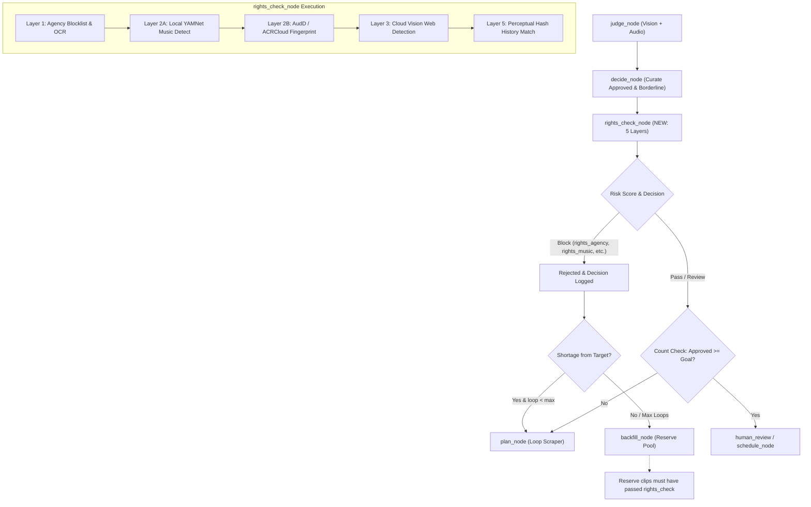

# Phase 6 Implementation Plan: Rights Check (5 Layers) & Claims Screen

> [!NOTE]
> **Boundary Disclaimer**: No automated rights-checking system can guarantee a clip will not receive a Content ID claim on YouTube. The YouTube Data API v3 does not expose Content ID claim data for standard channel accounts. This feature operates as a pre-upload risk filter, a scheduled review gate, and a learning loop. It does not address YouTube's separate "reused content" monetization policy.

---

## 1. Provider Proposals, Current Pricing & Limits

All providers are designed to be **pluggable**, with API keys stored securely in `.env`, strict daily call caps, hash-based caching, and graceful fallback to **Local-Only Mode** (Layers 1, 2A, and 5) with zero downtime.

| Component / Layer | Proposed Provider / Technology | Pricing & Free Tier | Limits & Quotas | Rationale & Recommendation |
| :--- | :--- | :--- | :--- | :--- |
| **Layer 1: Local OCR** | **`rapidocr-onnxruntime`** | **$0.00 (Free, Local)** | No rate limit; ~150ms / frame on CPU | Installs cleanly on Python 3.14/Windows with native wheels (`pyclipper`, `shapely`). Runs on our existing `onnxruntime 1.31.1` with zero C++ compilation or Tesseract installation required. |
| **Layer 2A: Local Music Detection** | **YAMNet (ONNX format)** | **$0.00 (Free, Local)** | No rate limit; ~200ms / clip on CPU | `inaSpeechSegmenter` requires `tensorflow`, which lacks standard wheels on Python 3.14 on Windows. YAMNet exported to ONNX (~15 MB) runs on `onnxruntime`, classifying AudioSet class #132 (Music) to calculate music seconds and fraction. |
| **Layer 2B: Audio Fingerprinting** | **AudD Music Recognition** *(Primary)*<br>*(Pluggable alternative: ACRCloud)* | **300 free requests** upon signup (no credit card required).<br>Paid: **$5.00 / month** for 1,000 requests (~$0.005 / request). | Default 100 req/min.<br>Fingerprints up to three 12s samples. | **Recommended**: AudD offers immediate free testing without credit card entry, predictable $5/mo pricing, and a simple JSON API. Pluggable interface allows toggling to ACRCloud (which offers a 14-day trial, then ~$0.01/req). |
| **Layer 3: Visual Match Check** | **Google Cloud Vision API** (`WEB_DETECTION`) | **First 1,000 units/month: $0.00 (Free Tier)**.<br>Beyond 1,000: $3.50 per 1,000 units. | Default 1,800 req/min.<br>2 raw frames per clip = ~360–480 req/month. | For 6 scheduled clips/day, monthly consumption is well under the permanent 1,000-unit monthly free allowance. |

---

## 2. Pipeline Integration & LangGraph Architecture



### LangGraph Placement
1. **Node Position**: `rights_check` is inserted directly after `decide` and before `count_check`.
2. **Selective Execution**: It runs **only** on clips marked `approved` or `borderline` by the judge, conserving provider calls and processing time.
3. **Rejection & Backfill**: Clips that fail are removed from `approved`/`borderline`, tagged with granular rejection codes (`rights_agency`, `rights_music`, `rights_visual_match`, `rights_history`, `rights_social_watermark`), and logged to `agent_decisions`. The existing loop back to `plan` or `backfill` handles any resulting quota deficit.
4. **Reserve Pool**: Any reserve clip selected by `backfill` must carry a verified passing rights check.

---

## 3. Five-Layer Detection Engine

### Layer 1: Agency and Source Blocklist (Local, Free)
- **Config**: `agent/config/agency_blocklist.yaml` containing normalized entries:
  - Known rights agencies: `ViralHog`, `Jukin Media`, `Storyful`, `Newsflare`, `Caters`, `Barcroft`, `Rumble Viral`, `CollabDRM`.
  - Social watermark indicators: `TikTok`, `Instagram`, `Reels`, `Facebook`, `CapCut`.
- **Fuzzy Match Engine**: Strips whitespace, punctuation, and casing; calculates Levenshtein edit distance allowing 1–2 character typos for words > 6 characters.
- **Evidence Streams**:
  1. Reddit title, flair, crosspost parent title/subreddit, and destination domain.
  2. OCR extracted text from 4–5 evenly sampled frames via `rapidocr-onnxruntime`.
  3. LLM vision judge output extended with `agency_or_social_names_seen`.
  4. Blocklisted uploaders and subreddits learned from past claims (Layer 5).
- **Outcome**: Immediate hard block (`rights_agency` or `rights_social_watermark`).

### Layer 2: Audio Check
- **Step 2A (Local Music Detection)**:
  - Extracted audio (16kHz mono) passed to local YAMNet ONNX model.
  - Generates `music_seconds` and `music_fraction`.
  - If `music_fraction < 0.10` and `music_seconds < 3`: Classified as speech/ambient only -> **Pass**.
- **Step 2B (Commercial Fingerprinting)**:
  - If music detected, sample up to three 12-second audio segments (beginning, middle, peak loudness).
  - Check file-hash cache. If miss, query recognition provider (AudD / ACRCloud).
  - Update `provider_usage` counter.
- **Decision Matrix**:
  - Commercial track recognized (confidence > threshold, duration > N seconds) -> **Hard Block** (`rights_music`), recording track title, artist, and label.
  - Music detected by Step 2A (> N seconds) but unrecognized by Step 2B -> **Needs Review** (`rights_music_unrecognized`).
  - Speech or ambient sound only -> **Pass**.

### Layer 3: Visual Match Check
- **Target**: Extract 2 keyframes from the **raw, unbranded** downloaded video (to avoid false matches on our own end screens or captions).
- **Execution**:
  - Check file-hash cache. If miss, query Google Cloud Vision `WEB_DETECTION`.
  - Record full image matches, partial matches, and matching page URLs/domains.
- **Scoring & Decision**:
  - Matches on known agency domains (e.g. `viralhog.com`, `jukinmedia.com`, `storyful.com`) -> **Hard Block** (`rights_visual_match`).
  - High match count on YouTube/TikTok or stock news sites -> **Needs Review**.
  - Matches restricted to `reddit.com` or `imgur.com` -> **Pass** (benign social distribution).

### Layer 4: YouTube Scheduled Review Gate & Hold Policy
- **Workflow Window**: Clips uploaded private and scheduled the evening prior remain in the `needs_check` review state.
- **Alerts**:
  - Notification immediately upon upload showing time remaining before the first slot.
  - Reminder notification at T-2 hours before slot time if still `needs_check`.
- **Config `rights.unreviewed_policy: publish | hold`**:
  - `publish` (default): Remains scheduled as planned.
  - `hold`: At T-30 minutes before slot time, if still `needs_check`, automatically calls YouTube API to clear `publishAt` and set status to private, preventing accidental public broadcast.
- **UI Actions**: "Mark Clear", "Mark Claimed", and "Hold" directly from the Claims dashboard.

### Layer 5: Learn from Claims & Perceptual Hashing
- **Perceptual Hashes (`ImageHash`)**: Computes dHash/pHash for 3 representative frames of every claimed clip and stores them in SQLite. Future uploads with Hamming distance < 8 are blocked as near-duplicates (`rights_history`).
- **Claim Suggestion Pipeline**:
  - Saving a claim auto-extracts candidate blocklist entries (claimant name, agency names in asset title, song title/artist, uploader, subreddit penalty).
  - Suggestions stay in a **Pending Confirmation** queue until explicitly approved by the user in the dashboard.
- **Claim Rate Metrics**: Computes claims per 100 published clips by subreddit, uploader, and layer to feed into future risk scoring.

---

## 4. Risk Score Calculation & Decision Matrix

```
rights_risk (0 to 100) = 
    (Agency/Watermark Match ? 100 : 0) +
    (Commercial Track Recognized ? 100 : 0) +
    (Perceptual Hash History Match ? 100 : 0) +
    (Agency Visual Match ? 100 : 0) +
    (Unrecognized Music Detected ? +35 : 0) +
    (High Web Match Count on Video Platforms ? +30 : 0) +
    (Clip Duration > rights.prefer_max_seconds (60s) ? +15 : 0) +
    (Subreddit Claim Rate > 10% ? +20 : 0)
```

- **Decision**:
  - **`block`** (Score ≥ 80 or any hard rule): Rejected, loop/backfill invoked.
  - **`review`** (Score between 30 and 79, or on provider error): Scheduled with `needs_check` flag.
  - **`pass`** (Score < 30): Clean bill of health.
- **Provider Error Policy (`rights.on_provider_error: review`)**: Provider timeouts, quota exhaustion, or API errors always fail closed to `review`, never silently passing.

---

## 5. Database Schema & Safe Migration (`agent/data/agent.db`)

Non-destructive migrations will add the following tables:

```sql
-- 1. Detailed per-clip rights evaluation log
CREATE TABLE IF NOT EXISTS rights_checks (
    id INTEGER PRIMARY KEY AUTOINCREMENT,
    post_id TEXT NOT NULL,
    target_date TEXT NOT NULL,
    checked_at TEXT NOT NULL,
    layers_json TEXT NOT NULL,       -- Results of L1, L2, L3, L5
    risk_score INTEGER NOT NULL,     -- 0 to 100
    decision TEXT NOT NULL,          -- 'pass', 'review', 'block'
    reasons_json TEXT NOT NULL,      -- Array of trigger reasons
    created_at TEXT DEFAULT CURRENT_TIMESTAMP
);

-- 2. Official Content ID claims tracking
CREATE TABLE IF NOT EXISTS claims (
    id INTEGER PRIMARY KEY AUTOINCREMENT,
    video_id TEXT,
    post_id TEXT NOT NULL,
    claim_type TEXT NOT NULL,        -- 'audio', 'visual', 'both'
    claimant TEXT NOT NULL,          -- e.g. 'CollabDRM', 'SME'
    asset_title TEXT,                -- e.g. 'Collab ViralHog...', 'Eye of the Tiger'
    found_in TEXT,                   -- Timestamp range in video (e.g. '0:04 - 0:18')
    action TEXT NOT NULL,            -- 'kept', 'held', 'pulled', 'disputed'
    noted_at TEXT NOT NULL,
    source_name TEXT,                -- e.g. 'reddit_funny'
    uploader TEXT,                   -- e.g. 'RedditUser123'
    phashes_json TEXT,               -- Perceptual hashes of video keyframes
    notes TEXT,
    created_at TEXT DEFAULT CURRENT_TIMESTAMP
);

-- 3. Dynamic blocklist learned from claims & user entries
CREATE TABLE IF NOT EXISTS rights_blocklist (
    id INTEGER PRIMARY KEY AUTOINCREMENT,
    type TEXT NOT NULL,              -- 'text', 'domain', 'uploader', 'subreddit', 'claimant', 'track', 'phash'
    value TEXT NOT NULL,
    source_claim_id INTEGER REFERENCES claims(id),
    status TEXT NOT NULL DEFAULT 'active', -- 'pending_confirmation', 'active', 'disabled'
    created_at TEXT DEFAULT CURRENT_TIMESTAMP
);

-- 4. Provider call and quota monitoring
CREATE TABLE IF NOT EXISTS provider_usage (
    id INTEGER PRIMARY KEY AUTOINCREMENT,
    day TEXT NOT NULL,               -- 'YYYY-MM-DD'
    provider TEXT NOT NULL,          -- 'audd', 'acrcloud', 'google_vision'
    calls INTEGER DEFAULT 0,
    errors INTEGER DEFAULT 0,
    UNIQUE(day, provider)
);

-- Extend uploads and schedule tables with non-breaking columns
-- (Added via PRAGMA table_info check before ALTER TABLE)
-- uploads.rights_status, uploads.rights_risk, uploads.claim_status
```

---

## 6. Dashboard: "Claims" Screen (4th Tab in Rail)

### Visual System & Tokens
- **Palette**: Pine (`#1D3B33`), Moss (`#2E7D4F`), Bandana (`#D4412F`), Amber (`#D97706`), Warm Slate (`#EDF0EC`).
- **Typography**: Bricolage Grotesque (headings) & Instrument Sans (body). Card border radius: `16px`.
- **Navigation**: 4th item in `Rail.tsx` (`<ShieldAlert size={20} />` icon, labeled "Claims").

### Screen Sections
1. **Needs Review Queue (Tomorrow's Scheduled Clips)**:
   - Card per scheduled clip: thumbnail, title, ET slot time, risk score badge (`Low`, `Review`, `High`).
   - Layer accordion: Agency findings (OCR match / clean), Audio (YAMNet music % + AudD track), Visual match (Google Cloud Vision domains).
   - Direct button link: **"Check in YouTube Studio"**.
   - Action buttons:
     - `Mark Clear`: Marks `rights_status = 'cleared'`, dismissing the review warning.
     - `Mark Claimed`: Opens modal dialog (claim type, claimant, asset title, timestamp range, action taken).
     - `Hold`: Sets video to private on YouTube and removes `publishAt` (reversible with `Unhold`).
2. **Pull and Replace Flow (Safe Transactional Order)**:
   - For any claimed or high-risk video:
     1. System queries `reserve_pool` for the highest-scoring clip that has passed `rights_check`.
     2. Uploads the reserve clip to YouTube in private scheduled mode for the **exact same slot time and publishAt**.
     3. Verifies new video exists and is scheduled.
     4. Updates local `schedule`, `uploads`, and `schedule.json`.
     5. Changes the claimed video status to `Hold` (private).
     6. If explicit delete requested: requires user to type the word `DELETE`. If video is already public, requires a second confirmation modal.
     7. Uses `token_manage.json` with transactional rollback if any step fails.
3. **Claims History Table**:
   - Filterable by date, type, claimant, source, and action taken.
4. **Learned Blocklist Manager**:
   - Table of active blocklist entries with toggle switch (Enable/Disable).
   - "Pending Confirmation" banner showing suggestions generated by recent claims with "Approve" or "Dismiss" buttons.
5. **Protection Status Widget**:
   - Active layers status checklist (Layer 1: Active, Layer 2: Active, Layer 3: Active, etc.).
   - Quota usage progress bars (e.g. Google Cloud Vision: 14 / 25 daily cap; AudD: 6 / 20 daily cap).
   - Local-Only Mode banner if provider credentials are unset or depleted.
   - Aggregate stats: Claims per 100 published clips, claim rate by subreddit.
6. **Cross-Screen Enhancements**:
   - **YouTube Screen**: Displays a claim badge/chip (`Claimed: SME` or `Needs Check`) on affected rows.
   - **Agent Screen**: Rejection reasons chart updated to show `rights_agency`, `rights_music`, `rights_visual_match`, `rights_history`.

---

## 7. CLI Utilities & Seed Data

### `rights_check.py` CLI Tool
- `python rights_check.py --file clip.mp4 --report`: Runs all 5 layers on a local video file and outputs a colored summary of each layer's findings, risk score, and final decision.
- `python rights_check.py --backtest`: Iterates over historical clips in `agent/data/published/` and reports which clips would have been flagged.

### Historical Claim Seed Data
Seed the `claims` table with the two known incidents:
1. **CollabDRM Visual Claim**:
   - Post ID: `reddit_1xrxt1u` / `reddit_1xv7kmf`
   - Claimant: `CollabDRM`
   - Asset Title: `Collab ViralHog - Female Pheasant Not Impressed By Mating Dance`
   - Type: `visual`
   - Acceptance: Layer 1 (ViralHog in title/OCR/domain) or Layer 3 (Cloud Vision matching ViralHog pages) catches or flags it for review.
2. **SME Audio Claim**:
   - Post ID: `reddit_1xrfauk` ("Goat Fights Its Own Reflection")
   - Claimant: `SME` (for Volcano)
   - Asset Title: `Eye of the Tiger` by Survivor
   - Type: `audio`
   - Acceptance: Layer 2 (YAMNet detects music > 80% of clip, AudD recognizes commercial track "Eye of the Tiger") produces an immediate hard block.

---

## 8. Implementation Status & Verification Summary

All Phase 6 components have been implemented, verified, and committed:

1. **Layer 1 (Agency & Source Blocklist)**:
   - Config: [agent/config/agency_blocklist.yaml](file:///C:/Drive-D/python%20tut/100B/agent/config/agency_blocklist.yaml)
   - Fuzzy matching with typo tolerance (1-2 typos) and punctuation/spacing insensitivity.
   - Local OCR via `rapidocr-onnxruntime` on 5 sampled frames.
   - Watermark rule: hard blocks social watermark text only if in corner or 2+ frames, otherwise flags for review.

2. **Layer 2 (Audio Check)**:
   - Local YAMNet ONNX model for zero-cost music detection.
   - AudD pluggable provider: 1 sample first, 2nd sample only if unrecognized and music_fraction >= 0.60.
   - Strict daily cap of 40 calls enforced.

3. **Layer 3 (Visual Match Check)**:
   - Google Cloud Vision API with `WEB_DETECTION` on 2 raw keyframes.
   - Runs in Local-Only mode by default; daily cap of 25 calls and budget alert threshold at 800 units/mo.

4. **Layer 4 (YouTube Review Gate & Actions)**:
   - `unreviewed_policy: hold` for first 14 days: uploaded private without publishAt.
   - "Mark Clear" sets publishAt or assigns next free slot if passed.
   - Desktop Windows WinRT toast notification + alerts log in `agent/logs/rights_alerts.log`.
   - Safe transactional Pull-and-Replace from reserve pool with rollback on failure.

5. **Layer 5 (Learn From Claims)**:
   - Database table `claims` seeded with `reddit_1xv7kmf` (CollabDRM visual) and `reddit_1xrfauk` (SME audio).
   - Near-duplicate perceptual hashing (< 8 Hamming distance) blocks future occurrences.
   - Auto-suggested blocklist entries populated for manual UI approval in `rights_blocklist`.

6. **Dashboard & UI**:
   - New **Claims** screen (`ClaimsView.tsx`) with protection status cards, needs-review queue, recently published (7 days) list (Keep, Make private, typed DELETE), claims history, and learned blocklist manager.
   - Warning modal on "disputed" action.
   - YouTube screen: `Claimed`, `Held`, and `Needs Check` badges displayed on rundown rows and player sidebar.
   - Agent screen: Rejection reasons chart updated with `rights_agency`, `rights_music`, `rights_visual_match`, `rights_history`, and `rights_social_watermark`.

7. **Verification**:
   - `python rights_check.py --backtest`: evaluated 13 historical clips, accurately blocked `reddit_1xrfauk` and flagged `reddit_1xv7kmf`.
   - `npm run test` (Frontend Vitest): 17/17 tests passed.
   - `npm run build` (Vite production bundle): built cleanly in 1.13s with zero errors.
   - `python -m pytest agent/tests dashboard/tests`: all 125 backend tests passed.
